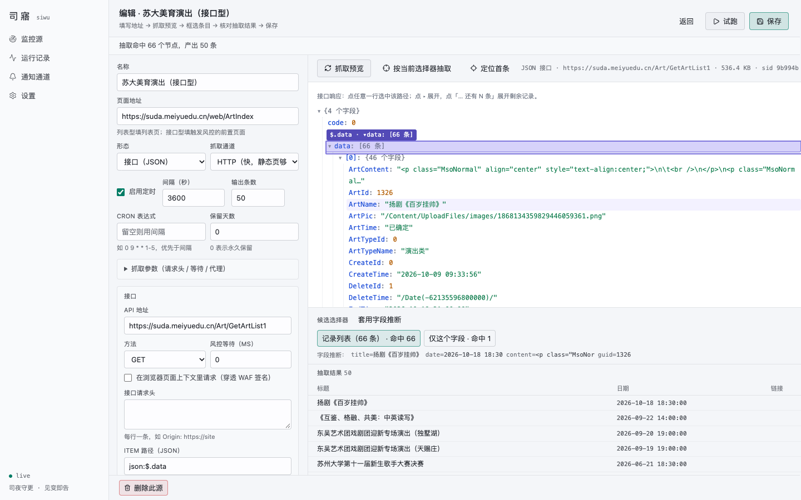

# 司寤 siwu · 架构与实现方案（v2 · 对齐 Felix2yu/.github 契约）

> 司夜守更，见变即告。
> 一个 Go 单体：把「网页任意区域的定时监控」统一成「RSS 订阅 + 即时通知」。

- v1（2026-10-22 03:59）：通用分层与模块划分。
- v2（2026-10-22 04:17）：以 `/Users/yufei/Git/.github` 统一规范为基准重排交付形态；依赖全取最新版并实测。
- **v3（本版，已落地）**：P0–P2 实现完成并通过真实站点验收；端口定为 **8788**；**抓取通道改为源级自选**（`http` / `browser`，在新建页面里选）；文末补「已实现 / 已知限制」。

所有版本号与兼容性结论均为 **2026-10-22 在本机实查实跑**（go proxy / npm registry / 真实 `pnpm install` + `vite build` + `go build`），不是记忆值。

---

## 1. 规范基线：本仓必须满足的 11 类契约

`.github` 仓库的契约不是建议，是**新仓库接入的门禁**（`scripts/check-*.py` 逐条扫）。下表把每条契约翻译成本仓的具体落法。

| # | 契约（文档） | 硬性要求 | 本仓落法 |
|---|---|---|---|
| 1 | 项目结构 `project-structure.md` | 仓库根 = Go 模块根；main 只在 `cmd/<app>/`；前端叫 `web/`；embed 位在 `internal/web/dist`；`scripts/build.sh`；产物落 `bin/` | `cmd/siwu/{main.go,version.go}`、`internal/*`、`internal/web/{embed.go,dist/.gitkeep}`、`web/`、`scripts/build.sh`、`bin/siwu` |
| 2 | 仓库基线 `repo-baseline.md` | README > 400B、LICENSE(MIT)、dependabot、ci.yml、前端三件套、`.gitignore`（含 Agent 目录块）、`codecov.yml`（project+patch 均 informational）、`.dockerignore`、`.editorconfig`/`.gitattributes`/`.golangci.yml` 逐字节同模板、Makefile 七目标 | 全部补齐；`.gitignore` 已含 `.workbuddy/` 等 11 个 Agent 目录 |
| 3 | 前端工具链 `frontend.md` | `.nvmrc` 在**仓库根**；`packageManager` 在 `web/package.json`；`pnpm-lock.yaml` 与 package.json 同级；只允许 pnpm；`eslint.config.js`(flat) + `prettier.config.js`；`lint = prettier --check . && eslint .` | `.nvmrc`=`26`；`"packageManager": "pnpm@12.14.0"`；`web/pnpm-lock.yaml`；`web/pnpm-workspace.yaml`（`minimumReleaseAge` / `onlyBuiltDependencies`） |
| 4 | 构建脚本 `build-script.md` | `#!/usr/bin/env bash`、`set -euo pipefail`、`ROOT`+`cd "$ROOT"`、`step`/`die`、产物 `bin/<app>`；`NODE_BIN` 按 `.nvmrc` 解析；`cp -R web/dist/. internal/web/dist/` 并补 `.gitkeep` | `scripts/build.sh` 照骨架写，另加 `--stage-only` 供 CI 复用（见 §8.2） |
| 5 | 命令入口 `makefile.md` | 七目标 `build/dev/test/lint/fmt/docker/clean`；`lint-strict` 独立；`docker` 依赖 `build`；`.PHONY` | 全部实现，另加 `check`（tsc+eslint）与 `fmt-web` |
| 6 | 容器 `docker.md` | 装配式（`COPY bin/siwu`）、`FROM ghcr.io/felix2yu/base:alpine-3.24`、非 root（PUID/PGID 由基镜）、`APP_DATA_DIR`、免鉴权探活 + `start-period`、exec form、`.dockerignore` 不得排除 `bin/` | 见 §8.3；`APP_DATA_DIR=/app/data`，`HEALTHCHECK → /api/healthz` |
| 7 | 格式基线 `code-style.md` | 三份文件逐字节同 `templates/`，改模板后 `sync-format-baseline.py` 分发，禁手改 | 复制 `editorconfig`/`gitattributes`/`golangci.yml`（v2 格式，`version: "2"`） |
| 8 | 依赖更新 `dependabot.md` | preset 整份覆盖；`gomod` + `npm(/web)` + `docker` + `github-actions` 四段；`open-pull-requests-limit: 10`；`timezone: Asia/Shanghai`；TS major 已有 ignore 带注释 | 见 §9 的 TS 例外；其余照抄 |
| 9 | 发布 `release.md` | `cmd/siwu/version.go` 的 `var version = "dev"` 必须**被真正引用**；版本唯一来源是 git tag | `--version` flag + 启动日志各引一次 |
| 10 | CPU 基线 `cpu-baseline.md` | `CGO_ENABLED=0` 走纯 Go 基线（GOAMD64=v1 默认）；产物**无 INTERP 段**；引入原生 SIMD 依赖须登记 | 全链路 cgo off（modernc sqlite 纯 Go），无 SIMD 依赖；`check-cpu-baseline.py` 首次运行会登记实测基线 |
| 11 | PWA `PWA.md` | 要么按图标七件套 + manifest + SW 全量接入，要么登记不做 | **登记不做**：告警走 ntfy/bark 直达手机，控制台是桌面产物；后续要装手机再按 §四全量接入 |

另外两件「接入即做」的事：

- **注册到自检脚本**：`check-repo-baseline.py` 的 `REPOS` 加 `"siwu": dict(lang="go", web="web")`（`check-repo-hygiene.py` 直接 import 它）、`check-docker.py` 加 `dict(df=["Dockerfile"], compose="docker-compose.yml")`、`check-cpu-baseline.py` 加基线登记。
- **同步文档表**：`.github/README.md` 第八节参数表、`docs/dependabot.md` 第二节表格各加一行。

---

## 2. 版本矩阵（全部为当前最新，实测可用）

查证时间 2026-10-22；「实测」列是本机真实执行结果，不是推断。

### 2.1 后端

| 依赖 | 版本 | 选它的理由 / 实测 |
|---|---|---|
| Go | **1.27.3** | 当前最新 stable（`go.dev/dl`）。本方案多处吃 1.27 新 API：`encoding/json/v2`、`http.CrossOriginProtection`、`os.Root`、`crypto/rand.Text`、`testing/synctest`、`iter.Seq2`。CI 读 `go.mod`，升级只改一行 |
| `modernc.org/sqlite` | **v1.61.0** | 纯 Go，`CGO_ENABLED=0` 即可，直接对上契约第 10 条，省掉 ntfy 那套 `static`/`glibc` 折腾 |
| `github.com/antchfx/htmlquery` | **v1.3.7** | XPath 1.0 over `x/net/html`，能力等价 lxml（`ancestor::`、`normalize-space()` 全支持） |
| `github.com/andybalholm/cascadia` | **v1.3.5** | CSS 选择器，与 htmlquery 共用同一棵树 |
| `github.com/gorilla/feeds` | **v1.2.0** | 生成 RSS 2.0 并输出 `content:encoded`（已实跑验证）；Atom/JSON Feed 另写 |
| `github.com/microcosm-cc/bluemonday` | **v1.0.27** | 正文 HTML 白名单净化（`UGCPolicy` 实测剥掉 `<script>` 保留 `<b>`） |
| `github.com/go-shiori/go-readability` | **v0.0.0-20251205110129-5db1dc9836f0** | 正文兜底（无伪版本可选，latest 即此） |
| `github.com/chromedp/chromedp` | **v0.21.0** | 只用 CDP 客户端连浏览器，不打包 Chrome。注意 v0.21 是**泛型新 API**（`Run[T]` / `Action[T]` / `remote.NewAllocator`），网上大量 `chromedp.Run(ctx, tasks...)` 的旧写法在这版编不过 |
| `github.com/unraid/apprise-go` | **v0.3.3** | 唯一即时通知层；`SupportedSchemas()` 实测返回 **214** 个协议 |
| `golang.org/x/net` / `x/text` / `x/sync` | **v0.61.0 / v0.43.0 / v0.24.0** | html 解析、编码嗅探、errgroup；均随上述库收敛 |

> 一次性验证：以上全部写进一个 `go.mod`（`go 1.27.3`）+ 一个 main 包，`go build` **通过**，`apprise` 打印 214、XPath/CSS 各命中 1、readability/chromedp 符号可用。

### 2.2 前端

| 依赖 | 版本 | 理由 / 实测 |
|---|---|---|
| Node | **26**（`.nvmrc`；当前 26.12.1） | 组织已全部拉平到 26，与基镜 `node:26-alpine` 对齐；属 current 非 LTS，符合「不考虑旧环境」 |
| pnpm | **12.14.0** | 最新。**关键实测：仍产出 `lockfileVersion: '9.0'`**，与组织现有 lock 格式一致，`--frozen-lockfile` 无障碍。新能力：安装时校验供应链策略，并自动把「发布过新」的包写入 `pnpm-workspace.yaml` 的 `minimumReleaseAgeExclude` |
| React / ReactDOM | **19.3.1** | Actions、`useActionState`、`useOptimistic`、`<Activity>`、`useEffectEvent` |
| Vite | **8.3.5** | 默认 Rolldown + oxc 转译；实测 2055 模块 **508ms → 260ms**（开 Compiler 后） |
| `@vitejs/plugin-react` | **6.1.2** | v6 用 oxc 转译，`compiler: true` 直接接 React Compiler（实测产出 `react.memo_cache_sentinel`，3 处） |
| `oxc-transform-react` | **0.155.0** | plugin-react 6 开 `compiler` 的必需 peer |
| `babel-plugin-react-compiler` | **1.0.0** | 已 GA；不需要手动挂 babel 插件（v6 走 oxc 路径） |
| Tailwind CSS + `@tailwindcss/vite` | **4.3.3** | CSS-first：`@import "tailwindcss"` + `@theme`，**没有 tailwind.config.js**；实测产物 4.4KB（gzip 1.5KB） |
| TypeScript | **6.0.3** | ⚠️ 唯一非最新项，理由见 §9.1（TS 7 与 typescript-eslint 互斥，有实测报错原文） |
| React Router | **8.5.0** | 数据路由（`createBrowserRouter` + loader/action），实测与 React 19.3 共同构建通过 |
| `@tanstack/react-query` | **5.104.5** | `queryOptions` / `useSuspenseQuery`，SSE 增量失效缓存 |
| `lucide-react` | **1.61.0** | 图标，tree-shaking 友好 |
| ESLint / `@eslint/js` | **10.13.0 / 10.0.1** | flat config 是唯一形态（eslintrc 已移除） |
| `typescript-eslint` | **8.72.0** | 实测 peer 上限 `<6.1.0`，决定 §9.1 |
| `eslint-plugin-react-hooks` | **7.1.1** | 支持 ESLint 10；`configs.flat.recommended` |
| `eslint-config-prettier` | **10.1.8** | 收尾关冲突规则 |
| Prettier | **3.9.10** | 需配 `.prettierignore`（否则会去格式化 `dist/` 与 lockfile，实测会直接失败） |
| Vitest | **5.0.5** | 与 Vite 8 同版本线 |
| `@testing-library/react` / `jest-dom` | **16.3.3 / 7.0.1** | 组件测试 |

> 一次性验证：`pnpm install`（12.14.0）零 peer 告警；`tsc --noEmit` 通过；`vite build` 通过；`eslint .` 退出码 0；`pnpm install --frozen-lockfile` 26ms 通过。

### 2.3 镜像与 CI

| 项 | 值 | 说明 |
|---|---|---|
| 运行时基镜 | `ghcr.io/felix2yu/base:alpine-3.24` | 唯一豁免 digest 的 `FROM`；含 tzdata/TZ、su-exec、`app` 用户、降权入口 |
| Runner | `ubuntu-26.04` / `ubuntu-26.04-arm` | 契约要求写死版本，禁 `-latest` |
| cgo | `off` | 单 runner 交叉编译出 5 平台 |
| 外置浏览器 | `chromedp/headless-shell:156.0.8078.48` | 只在 compose `browser` profile 里出现，**不进 siwu 镜像**；本机调试也可用 `SIWU_CHROME_PATH` 指向任意 Chromium |

---

## 3. 总体架构

```
┌─────────────────────────────────────────────────────────────────────┐
│ web/  React 19.3 + Compiler + Vite 8(Rolldown) + Tailwind 4.3       │
│ ── pnpm build ──▶ web/dist ──stage──▶ internal/web/dist (go:embed)  │
└───────────────┬──────────────────────────────┬──────────────────────┘
                │ /api/*  JSON(v2) + SSE       │ /f/{slug}.xml
┌───────────────▼──────────────────────────────▼──────────────────────┐
│ internal/httpapi  标准库 ServeMux 方法路由 + CrossOriginProtection   │
│                   ETag/304 · gzip · 会话鉴权 · SSE                   │
├─────────────────────────────────────────────────────────────────────┤
│ internal/probe        │ internal/scheduler     │ internal/feedgen   │
│ 预览代理·净化·picker   │ 最小堆·worker·租约·退避 │ RSS/Atom/JSONFeed  │
├─────────────────────────────────────────────────────────────────────┤
│ internal/pipeline（唯一写入路径；试跑与定时只差 dry_run）            │
│ fetch → extract → transform → filter → dedup → article → feed → notify│
├──────────┬──────────┬──────────┬──────────┬──────────┬──────────────┤
│ fetch    │ extract  │transform │ article  │ diff     │ notify       │
│ http/CDP │ xpath/css│ 规则管线 │ readability│ 快照/新增│ apprise-go  │
├──────────┴──────────┴──────────┴──────────┴──────────┴──────────────┤
│ internal/store  SQLite(modernc, cgo off) · embed 迁移 · iter.Seq2    │
└─────────────────────────────────────────────────────────────────────┘
        ▲
        └── 外置浏览器（可选）：SIWU_BROWSER_WS → headless-shell（compose profile）
```

与 v1 相比的结构性变化：

1. **去掉 chi/gin**：Go 1.22+ 的 `ServeMux` 已支持 `GET /api/sources/{id}` 方法+通配路由，够用且少一个依赖。
2. **浏览器外置**：镜像保持「只有二进制」，渲染能力通过 CDP 连外部 headless-shell，同时满足「装配式镜像」与「不牺牲 JS 站点」。
3. **JSON 换 `encoding/json/v2`**：DTO 与配置直接用新语义（大小写敏感、拒绝重复键），不再靠 tag 兜底。

---

## 4. 模块划分

| 包 | 职责 | 关键实现点（新特性落点） |
|---|---|---|
| `cmd/siwu` | flag 解析、装配、启动、优雅退出 | `signal.NotifyContext`；`version.go` 的 `version` 被 `--version` 与启动日志引用 |
| `internal/config` | env/flag 合并、密钥派生、SSRF 白名单 | `SIWU_*` 环境变量；`crypto/rand.Text()` 生成默认 session secret |
| `internal/model` | Source/Entry/Snapshot/Run/Target | 纯结构体，无 ORM tag 依赖 |
| `internal/store` | 连接(WAL)、embed 迁移、repo、事务 | `embed.FS` 存 SQL；`iter.Seq2[Entry, error]` 流式读条目；**单写者**串行化 |
| `internal/fetch` | HTTP 抓取、charset 嗅探、条件请求、重试；CDP 分支 | `http.Client` + `x/text/encoding`；浏览器走 `chromedp.NewRemoteAllocator` |
| `internal/extract` | 选择器 DSL：XPath/CSS/JSONPath/模板 | htmlquery + cascadia；字段 = 元素 + attr + fallback |
| `internal/transform` | 清洗规则管线（去 `NEW`、日期归一、模板） | 纯函数；`regexp`（RE2）编译期校验 |
| `internal/article` | 正文抽取、链接绝对化、净化 | readability → bluemonday → `content:encoded` |
| `internal/diff` | 归一化、hash、忽略正则、行级 diff | 文本 sha256 + 阈值判定 |
| `internal/feedgen` | RSS 2.0 / Atom / JSON Feed 1.1 | gorilla/feeds + 手写 JSON Feed |
| `internal/notify` | apprise-go 封装、策略、限流、模板 | `apprise.New()` + `AddAll` + `WithInputFormat("html")`；`errors.As(*TargetError)` 拆到单 URL |
| `internal/scheduler` | 最小堆 + worker 池 + 租约 + 退避 | 测试用 `testing/synctest` 假时钟，不 sleep |
| `internal/probe` | 预览代理、净化、picker 注入、命中计数、字段推断 | `os.Root` 限制导出/缓存目录；预览会话 TTL |
| `internal/httpapi` | 路由、DTO、SSE、RSS 端点、鉴权 | `ServeMux` 方法路由 + `http.CrossOriginProtection` |
| `internal/web` | `//go:embed all:dist` + `FS()`/`HasBuild()` | 必须自带 `embed_test.go`（契约：新建包必须有测试，否则 codecov patch 打红） |
| `web/` | React 前端工程 | §2.2 |

---

## 5. 核心设计（相对 v1 的强化点）

### 5.1 选择器 DSL

```
[css:|xpath:|json:] <expr> [@attr]
```

```jsonc
{
  "item": "xpath://div[@id='news']//li[contains(@class,'row')]",
  "limit": 50,
  "fields": {
    "title": { "sel": "xpath:.//h2/a", "transform": ["strip-new"] },
    "link":  { "sel": "xpath:.//h2/a", "attr": "href", "absolute": true },
    "date":  { "sel": "css:time", "attr": "datetime", "fallback": ["css:span.date"] },
    "guid":  { "template": "{link}" }
  }
}
```

- XPath 优先（站点列表常无稳定 class）；CSS 作为短写法；JSONPath 覆盖 pageapi 型。
- 属性统一用「元素节点 + `attr`」，不用 `//a/@href` 属性节点形态（htmlquery 对属性节点返回形态不一致，v1 探针已踩到）。

### 5.2 可视化框选（核心差异化，且与镜像契约兼容）

跨域 iframe 读不到 DOM、`X-Frame-Options: DENY` 直接不加载 —— 所以走**同源预览代理**：

```
POST /api/probe/fetch {url, engine}
  ├─ http 通道：服务端抓 HTML → 净化 → 注入 <base href="目标"> + picker.js
  └─ cdp  通道：经 SIWU_BROWSER_WS 连外置 headless-shell
                → 等 networkidle → document.documentElement.outerHTML 快照 → 同样净化注入
  → 预览会话（TTL 10min）→ 返回 sid
GET /api/preview/{sid}   ← iframe sandbox="allow-scripts"（不给 allow-same-origin）
```

净化（安全边界）：删 `script/iframe/object/embed`、清 `form[action]`、剥 `on*`、去 CSP meta、注入 `<base>`。picker 与父页仅 `postMessage` 通信。

交互：悬浮高亮 → 点击选中（`↑/↓` 切父/子）→ 后端产出候选（精确路径 / **重复块泛化** / 同标签兄弟）并各取命中数 → 字段推断（`a[href]`/`time`/`.date`）→ 抽取结果表。

#### 接口型的预览：可点选的 JSON 树

接口响应用 `<pre>` 全文展示时能看不能选。现在响应被渲染成一棵**可点选的 JSON 树**：每行带
`data-jpath`（`$.data[0].ArtName`），点一行就把路径回传给编辑器；`▸` 折叠、`… 还有 N 条` 展开剩余记录。
后端按会话形态路由：

| 场景 | 预览内容 | 抽取走哪条 |
|---|---|---|
| `kind=json` + `api.url` | 抓 `api.url`（与正式运行同一条通道，含 in_browser 的 WAF 签名） | `extract.JSON` |
| 响应体是 JSON（不论 kind） | JSON 树 + 提示「改类型为接口型」 | 按会话 `Kind=json` |
| 普通页面 | 净化后的 HTML + picker | `extract.HTML` |

点字段时后端以「该字段所属的那条记录」为根推断字段（`title=$.ArtName`、`date=$.StartTime`、
`guid=$.ArtId`），条目候选直接给所属数组（`json:$.data`，含命中数），与 HTML 侧的「以条目节点为根」同理。
`json:` 前缀只是书写习惯，`extract.JSON` 与保存校验都会剥掉。



**空壳页面**：列表由脚本异步渲染时，HTTP 通道抓到的快照里没有条目，框选无从下手。
`shellPageHint` 会识别这种情况（脚本里有 `$.get/fetch` 取数调用、页面里却没有 `li/tr/article` 结构），
并从脚本里把接口地址捞出来直接写进提示：*「把 /Art/GetArtList1 填进 api.url」*。

实现时踩到的点，都已修在代码里：

1. **picker 必须内联注入**，不能用 `<script src="/picker.js">`：预览页里有 `<base href="目标站">`，相对路径会被解析到目标站去。
2. **字段推断的根必须是「条目节点」**，不是被点中的那个节点。用户点的通常是标题 `<a>`，若以它为根，推断出的 `sel` 是 `.`，一旦把条目换成父级 `li` 就全错。现在 `/api/probe/suggest` 接受 `item` 参数，以条目选择器命中的第一个节点为根重新推断。
3. **重复块签名不能直接当 XPath**：`li|news` 这种用于比较的签名必须转成 `li[contains(@class,'news')]` 才能求值，否则候选会被静默丢弃。

**为什么外置浏览器**：契约第 6 条要求镜像只 COPY 二进制；把 Chrome 塞进 siwu 镜像会让 alpine 镜像 +400MB，且 `check-docker.py` 的装配式检查失去意义。`docker compose --profile browser up` 起一个 `headless-shell`，`SIWU_BROWSER_WS=ws://browser:9222` 即启用；不启用则纯 HTTP 通道，零额外体积。

### 5.3 清洗与正则化

```jsonc
[
  { "id": "strip-new", "target": ["title"], "op": "regex_replace",
    "pattern": "\\s*[\\[【(（]?NEW[\\]】)）]?\\s*$", "replace": "", "flags": "i" },
  { "id": "strip-site", "target": ["title"], "op": "regex_replace",
    "pattern": "\\s*[-_|]\\s*某某大学新闻网\\s*$", "replace": "" },
  { "id": "date-cn", "target": ["date"], "op": "date_parse",
    "layouts": ["2006-01-02", "2006/01/02", "01-02"], "tz": "Asia/Shanghai" }
]
```

- op 集合：`trim` `collapse_ws` `lower` `regex_replace` `regex_extract` `strip_prefix` `strip_suffix` `remove_tags` `html_unescape` `date_parse` `truncate` `template`。
- 保存时编译正则并校验（RE2 不支持 lookaround，前端要提前提示）。
- **清洗必须早于去重**，否则 `标题 NEW` 与 `标题` 会成为两条。

### 5.4 去重与更新语义

| 字段 | 作用 |
|---|---|
| `entry_key` = `sha256(source_id \| guid_key)` | 唯一索引，决定「是不是同一条」 |
| `content_hash` | 决定「同一条是否被改过」 |

策略 `ignore`（默认）/ `update`（公告改了截止时间要同步并可选再通知）/ `archive`（榜单快照保留版本）。page 型另有 `min_changed_lines` 阈值压噪。

### 5.5 通知

`apprise.New()` + `AddAll(urls)` + `Send(body, WithTitle, WithNotifyType, WithInputFormat("html"))`；错误是 `errors.Join` 的 `*TargetError`，可拆到单个 URL 报给 UI。214 协议覆盖 ntfy/tgram/bark/wecom/feishu/dingtalk/json。

策略：`trigger`（new/change/summary/failure/recovery）× `timing`（immediate / batch 30s / digest）× `throttle`（同源 60s）× `quiet_hours` × `detail`。每条 entry 记 `notified_at`，同条不重发；失败重试 3 次后写 run 警告，不阻塞入库与 RSS。

### 5.6 调度与容错

最小堆 + worker 池（默认 4）+ 单源租约（`runs` 表 running + lease）+ 指数退避（`min(interval, 60s×2^n)`，上限 1h，带整分钟漂移）+ 连续 3 次 0 条告警（静默失效比报错隐蔽）。测试用 `testing/synctest` 把退避与租约压缩到毫秒级。

### 5.7 RSS 输出

`/f/{slug}.xml|.atom|.json`；`ETag`(sha256) + `Last-Modified` + `304` + gzip；排序 `COALESCE(published_at, first_seen_at) DESC`；`max_items` 默认 50；私有订阅用 `?k=` 令牌（`crypto/rand.Text()` 生成）。导出落盘走 `os.Root`，杜绝路径穿越。

---

## 6. 数据模型

```sql
CREATE TABLE sources (
  id INTEGER PRIMARY KEY, slug TEXT NOT NULL UNIQUE, name TEXT NOT NULL,
  kind TEXT NOT NULL,                      -- list | page | rss | json
  url TEXT NOT NULL, enabled INTEGER NOT NULL DEFAULT 1,
  engine TEXT NOT NULL DEFAULT 'http',     -- http | cdp
  request_json TEXT NOT NULL DEFAULT '{}', extract_json TEXT NOT NULL DEFAULT '{}',
  rules_json TEXT NOT NULL DEFAULT '[]',   filter_json TEXT NOT NULL DEFAULT '{}',
  article_json TEXT NOT NULL DEFAULT '{}', policy_json TEXT NOT NULL DEFAULT '{}',
  created_at INTEGER NOT NULL, updated_at INTEGER NOT NULL,
  last_run_at INTEGER, next_run_at INTEGER,
  consecutive_failures INTEGER NOT NULL DEFAULT 0
);

CREATE TABLE entries (
  id INTEGER PRIMARY KEY,
  source_id INTEGER NOT NULL REFERENCES sources(id) ON DELETE CASCADE,
  entry_key TEXT NOT NULL, guid TEXT NOT NULL,
  title TEXT, link TEXT, summary TEXT, content_html TEXT, content_text TEXT,
  category TEXT, published_at INTEGER, first_seen_at INTEGER NOT NULL, updated_at INTEGER,
  content_hash TEXT, notified_at INTEGER,
  UNIQUE(source_id, entry_key)
);
CREATE INDEX idx_entries_feed ON entries(source_id, COALESCE(published_at, first_seen_at) DESC);

CREATE TABLE snapshots (source_id INTEGER PRIMARY KEY REFERENCES sources(id) ON DELETE CASCADE,
  hash TEXT NOT NULL, text TEXT NOT NULL, captured_at INTEGER NOT NULL);

CREATE TABLE runs (id INTEGER PRIMARY KEY, source_id INTEGER NOT NULL,
  started_at INTEGER NOT NULL, finished_at INTEGER, status TEXT NOT NULL,
  trigger TEXT, items_found INTEGER, items_new INTEGER, items_updated INTEGER,
  duration_ms INTEGER, error TEXT, warnings_json TEXT);

CREATE TABLE targets (id INTEGER PRIMARY KEY, name TEXT NOT NULL, url_enc BLOB NOT NULL,
  kind TEXT, enabled INTEGER NOT NULL DEFAULT 1, created_at INTEGER);
CREATE TABLE source_targets (source_id INTEGER NOT NULL, target_id INTEGER NOT NULL,
  PRIMARY KEY(source_id, target_id));
CREATE TABLE settings (key TEXT PRIMARY KEY, value TEXT NOT NULL);
```

- 单用户：**无 users 表**；`SIWU_PASSWORD` 为空则只监听回环，非空则会话 Cookie（`rand.Text()` 作 session id）。
- `targets.url_enc`：webhook 里含 token，用 `SIWU_SECRET` 派生的 AES-GCM 加密落库，API 只回显掩码。
- 迁移：`internal/store/migrations/*.sql` + `//go:embed`，`schema_migrations` 记录版本，启动时事务内顺序执行。

---

## 7. 目录结构（严格对齐 `project-structure.md`）

```
siwu/                          # 仓库根 = Go 模块根
├── go.mod  go.sum              # module github.com/Felix2yu/siwu；go 1.27.3
├── cmd/siwu/
│   ├── main.go                 # flag/装配/启动/优雅退出
│   └── version.go              # var version = "dev"（--version + 启动日志引用）
├── internal/
│   ├── api/ config/ model/ store/ fetch/ extract/ transform/ article/
│   ├── diff/ feedgen/ notify/ scheduler/ probe/ pipeline/
│   └── web/
│       ├── embed.go            # //go:embed all:dist + FS() + HasBuild()
│       ├── embed_test.go       # 断言占位态/构建态自洽 + FS 可遍历
│       └── dist/.gitkeep
├── web/
│   ├── src/ public/ scripts/
│   ├── package.json            # "packageManager": "pnpm@12.14.0"
│   ├── pnpm-lock.yaml  pnpm-workspace.yaml
│   ├── vite.config.ts  tsconfig.json
│   ├── eslint.config.js  prettier.config.js  .prettierignore
│   └── dist/                   # gitignore
├── scripts/
│   ├── build.sh                # 唯一构建实现（含 --stage-only）
│   └── smoke.sh                # 起服务 + curl /api/healthz + /f/demo.xml
├── bin/                        # gitignore；Dockerfile COPY 源
├── data/                       # gitignore；本地开发库
├── docs/architecture.md
├── .github/workflows/ci.yml    # 薄调用，pin @v1
├── .github/dependabot.yml      # preset 整份覆盖
├── .nvmrc                      # 26
├── .editorconfig  .gitattributes  .golangci.yml   # 逐字节同 templates/
├── .gitignore  .dockerignore   # 后者不得排除 bin/
├── codecov.yml                 # project/patch 均 informational
├── Dockerfile  docker-compose.yml  Makefile
├── README.md  LICENSE  AGENTS.md  .env.example
└── .workbuddy/                 # 本地 Agent 目录，已 gitignore
```

---

## 8. 交付形态（装配式）

### 8.1 `.github/workflows/ci.yml`（薄调用）

```yaml
name: CI
on:
  push: { branches: [main], tags: ['v*'] }
  pull_request: { branches: [main] }
  release: { types: [published] }
  repository_dispatch: { types: [base-image-updated] }
  schedule: [{ cron: '0 3 * * 1' }]
  workflow_dispatch:
permissions: { contents: read }
concurrency:
  group: ${{ github.workflow }}-${{ github.ref }}
  cancel-in-progress: ${{ github.event_name == 'pull_request' }}

jobs:
  test:
    uses: Felix2yu/.github/.github/workflows/reusable-test.yml@v1
    secrets: { CODECOV_TOKEN: '${{ secrets.CODECOV_TOKEN }}' }
    with:
      go-dir: .
      test-packages: ./internal/...        # cmd 带 go:embed，./... 在未构建前端时会失败
      test-flags: -race -covermode=atomic
      web-dir: web
      web-build-command: pnpm run check && pnpm run build
      web-test-command: pnpm run test
      frontend-coverage-file: web/coverage/lcov.info
      codecov-flag-go: backend
      codecov-flag-web: frontend

  image:
    needs: test
    permissions: { contents: read, packages: write }   # 必须显式声明，否则 GHCR 403
    uses: Felix2yu/.github/.github/workflows/reusable-image.yml@v1
    with:
      go-dir: .
      main-package: ./cmd/siwu
      binary-name: siwu
      image-name: ghcr.io/felix2yu/siwu
      web-dir: web
      frontend-stage-command: bash scripts/build.sh --stage-only

  release:
    if: github.event_name == 'release'
    permissions: { contents: write }
    uses: Felix2yu/.github/.github/workflows/reusable-release.yml@v1
    with:
      go-dir: .
      main-package: ./cmd/siwu
      binary-name: siwu
      web-dir: web
      frontend-stage-command: bash scripts/build.sh --stage-only
```

关键取舍：`frontend-stage-command` 调 `build.sh --stage-only`，**不新写一份 `cp` 逻辑**——契约要求 build.sh 是唯一构建实现，复制粘贴的第二个 stage 实现必然漂移。

### 8.2 `scripts/build.sh`（五条硬约定 + 一个扩展）

```bash
#!/usr/bin/env bash
# 司寤构建脚本 —— 从 Go 源 + web/ 前端构建出 bin/siwu（内嵌前端）
# 产物：bin/siwu
# 前置：Go 1.27+ / Node 26 + pnpm 12
# 用法：./scripts/build.sh [--stage-only]
set -euo pipefail
ROOT="$(cd "$(dirname "${BASH_SOURCE[0]}")/.." && pwd)"; cd "$ROOT"
step() { printf '\033[1;34m==>\033[0m %s\n' "$1"; }
die()  { printf '\033[1;31m错误：\033[0m %s\n' "$1" >&2; exit 1; }
```

- `NODE_BIN`：读 `.nvmrc` 主版本 → PATH/nvm/Homebrew 找，**低于声明即 die**，高于告警放行；确定后立刻 `export PATH="$(dirname "$NODE_BIN"):$PATH"`。
- `--stage-only`：跳过前端构建与 go build，只做 `rm -rf internal/web/dist/*` → `cp -R web/dist/. internal/web/dist/` → `touch .gitkeep`。供 CI 的 `frontend-stage-command` 复用。
- 最后 `mkdir -p bin && go build -trimpath -ldflags "-s -w" -o "$ROOT/bin/siwu" ./cmd/siwu`。

### 8.3 `Dockerfile`（装配式，唯一形态）

```dockerfile
FROM ghcr.io/felix2yu/base:alpine-3.24
WORKDIR /app
ENV APP_DATA_DIR=/app/data
COPY --chmod=755 bin/siwu /app/siwu
EXPOSE 8788
HEALTHCHECK --interval=30s --timeout=3s --start-period=5s --retries=3 \
  CMD wget -q -O- http://127.0.0.1:8788/api/healthz >/dev/null || exit 1
CMD ["/app/siwu", "serve", "--addr", ":8788", "--data", "/app/data"]
```

四个「不能省」：探活端点**免鉴权**（`/api/healthz`）、`start-period=5s`（首启建表）、exec form（信号可达，`docker stop` 不超时 10s，SQLite WAL 才来得及 checkpoint）、`APP_DATA_DIR=/app/data` 让基镜按 PUID/PGID 做 `chown -R`。

### 8.4 `docker-compose.yml`（含可选浏览器 profile）

```yaml
services:
  siwu:
    image: ghcr.io/felix2yu/siwu:latest
    ports: ["8788:8788"]
    environment:
      PUID: "1000"
      PGID: "1000"
      TZ: Asia/Shanghai
      SIWU_BASE_URL: http://localhost:8788
      # SIWU_BROWSER_WS: ws://browser:9222     # 启用 browser profile 时打开
    volumes: ["./data:/app/data"]
    restart: unless-stopped
  browser:
    image: chromedp/headless-shell:<pinned>   # 必须 pin 具体 Chrome 版本 tag
    profiles: ["browser"]
    shm_size: "1gb"
    restart: unless-stopped
```

### 8.5 `Makefile`（七目标 + 扩展）

```makefile
BIN  := bin/siwu
MAIN := ./cmd/siwu
.PHONY: build dev test lint lint-strict fmt docker clean check stage

build:      ; ./scripts/build.sh
dev:        ; go run $(MAIN) serve --addr :8788 --data ./data   # 前端另开终端 cd web && pnpm dev
test:       ; go test ./internal/... && cd web && pnpm run test
lint:       ; test -z "$$(gofmt -l .)" && go vet ./... && cd web && pnpm run check
lint-strict: lint
	@command -v golangci-lint >/dev/null 2>&1 && golangci-lint run || echo "（未安装，跳过）"
fmt:        ; gofmt -w . && cd web && pnpm exec prettier --write .
docker: build
	docker build -t siwu:dev .
clean:      ; rm -rf bin/* internal/web/dist/* && touch internal/web/dist/.gitkeep
```

`clean` 用 `dist/*` 而非 `rm -rf dist`：后者会删掉 tracked 的 `.gitkeep`，工作区从此常挂一条删除记录。

---

## 9. 版本例外与风险

### 9.1 唯一例外：TypeScript 固定 6.0.3（不是 7.0.2）

实测证据（本机，2026-10-22）：

| 组合 | 结果 |
|---|---|
| `typescript@7.0.2` + `tsc --noEmit` | ✅ 通过，0.24–0.33s |
| `typescript@7.0.2` + `eslint .` | ❌ `typescript-eslint does not support TS 7.0.`（加载即抛，非规则告警） |
| `typescript-eslint@8.72.0` 的 peer | `>=4.8.4 <6.1.0`（canary 8.72.1-alpha.7 仍未放宽） |
| `typescript@6.0.3` + 全链 | ✅ install / tsc / build / eslint 全绿 |

选择：**6.0.3**（6.x 最新），理由是与 `frontend.md` 的「ESLint flat config + ts configs 全开」契约一致；TS 7 换来的只是 0.3s 级收益（本项目规模），却要放弃 typed lint。
配套：`dependabot.yml` 里 typescript major 的 ignore **保留并改注释**为本仓理由；`typescript-eslint` issue #10940 支持 TS 7 后，删 ignore + 改一行版本即可。
备选（若你更看重 TS 7）：改 `oxlint@1.89.0` 做主 linter、放弃 ESLint + typescript-eslint，但会偏离 `frontend.md`，属契约变更，要单独在 `.github` 提。

### 9.2 其它需要盯的点

| 风险 | 现状 / 对策 |
|---|---|
| pnpm 12 的供应链策略会拦「发布过新」的包 | 显式写 `minimumReleaseAge: 1440`；被拦的包进 `minimumReleaseAgeExclude` 并**注明原因**（首次安装已自动写入 `vite@8.3.5`、`lucide-react@1.61.0`） |
| pnpm 10+ 默认不跑依赖构建脚本 | 本项目唯一可能需要的是 `fsevents`（macOS）；需要时写 `onlyBuiltDependencies` |
| Vite 8 用 Rolldown，个别插件未适配 | 只用官方 `@vitejs/plugin-react` + `@tailwindcss/vite`，实测通过；任何新插件先跑 `pnpm build` |
| React Compiler 在 plugin-react 6 里标 `@experimental` | 实测产出 memo cache（3 处）、构建通过；若遇疑难，`compiler: false` 一行回退，不影响其它 |
| 外置浏览器成为可选依赖 | 默认 http 通道；`browser` profile 才起 headless-shell；`engine: cdp` 的源在无浏览器时报明确错误而非静默 0 条 |
| 预览代理 = SSRF 面 | 默认拒私网/回环（`SIWU_ALLOW_PRIVATE=1` 放开）、8MB/20s/5 跳上限、剥脚本、iframe 无 `allow-same-origin` |
| apprise-go 协议覆盖不如 Python 版 | UI 只列 `SupportedSchemas()` 实返的 214 个；`json/jsons` 兜底自建 webhook |

---

## 10. 实施计划（按契约先行重排）

| 阶段 | 内容 | 验收（可执行） |
|---|---|---|
| **P0 规范骨架** ✅ | 目录树、go.mod、`cmd/siwu`+version、`internal/web` embed + 测试、`.nvmrc`/三件套、三份格式模板、Makefile、build.sh、ci.yml、dependabot、codecov、LICENSE/README/AGENTS | 已达成：`./scripts/build.sh` 产出 20MB 二进制；`./scripts/smoke.sh` 通过；`go vet` + `tsc` + `eslint` 全绿 |
| **P1 后端主链** ✅ | store+迁移、source CRUD、fetch(http)、extract(xpath/css/json)、feedgen、`/f/{slug}.xml` | 已达成：三个真实站点抓取成功（见 §10.1），RSS 含 `content:encoded` 且可被 XML 解析 |
| **P2 框选器** ✅ | probe 代理+净化+picker、候选+命中数、重复块泛化、字段推断、结果表 | 已达成：Playwright 实跑「点标题 → 2 个候选 → 重复块 12 条 → 套用推断 → 12 行结果」 |
| **P3 增强** ✅ | 清洗管线、过滤（含/排除 × 文本/正则）、page 快照 diff + 阈值、正文抽取、去重三策略、条目级排除选择器、归一化判重 | `pipeline_test.go` 7 个用例覆盖：NEW 去除、计数噪声不误判更新、广告排除、阈值、RSS 转发、关键词过滤 |
| **P4 调度与通知** ✅ | cron + 租约 + 退避、连续空跑告警、batch/digest 合并、重试 3 次、已通知标记、静默时段、详细度、SSE | `scheduler_test.go` 7 例（cron/退避/租约上限）；`notify_test.go` 10 例；本机接收端实测五类通知全部收到 |
| **P5 交付** 🚧 | 前端精修、Docker 单镜像、compose（含 browser profile）、导入导出、smoke.sh | 前端 5 个页面已回归；OPML 导出、gzip/ETag/`?k=` 令牌实测；`docker compose up` 尚未在本轮跑（见 §12） |

依赖：P0 必须最先（否则后面每个 PR 都要顺带补契约）→ P1/P2 可并行 → P3 → P4 → P5。

### 10.1 真实站点验收记录（2026-10-22）

| 站点 | 形态 / 通道 | 选择器 | 结果 |
|---|---|---|---|
| `visitsz.wglj.suzhou.com.cn/news.aspx` | 列表 / http | `xpath://div[contains(@class,'content-outer') and contains(@class,'list')]//ul/li` | 命中 12 条，标题/日期/绝对链接正确，详情页正文经 readability 入库（约 1KB/条），单次运行 531ms |
| `suda.meiyuedu.cn/web/ArtIndex` | 接口 / http | `item=$.data`，字段 `$.ArtName` / `{$.ArtId}` 模板 / `$.StartTime` | 命中 50 条，日期归一为 +08:00，`ArtContent` 净化后入正文，234ms |
| `szwtfz.maitix.com/h5/` | 接口 / **browser** | `item=$.data.dataList`，`in_browser: true`，`wait_ms: 6000` | 在页面上下文里请求 `client.maitix.com` 接口成功，命中 1 条（今日仅 1 个项目），8.9s（含 6s 风控等待） |

同日核对：`/f/visitsz.xml` 12 个 `<item>`、24 处 `content:encoded` 标签（开+闭），XML 可解析；
`/f/suda.json` 为 JSON Feed 1.1，`max_items=30` 生效。

### 10.2 第二轮验收：完整功能链路（2026-10-22 04:50–05:10）

| 用例 | 配置 | 结果 |
|---|---|---|
| 迁移不误报 | 旧库（旧哈希算法）升级到新哈希 | 12 条命中、0 新增、0 更新；`0002_rehash_baseline` + 「空哈希只补基线」生效 |
| RSS 转发 | `kind=rss` → `http://127.0.0.1:8790/f/visitsz.xml` | 12 条入库，24ms；二次运行 0 新增 |
| 页面快照 | `kind=page`，`scope=css:div.content`，`min_changed_lines=2` | 首次「首次快照」；二次 0 新增；区域命中 9 个只取第一个并给出告警 |
| 新条目通知 | 本地可控站点 + `json://` 目标 | 收到 `[通知验收源] 2 条新内容`，摘要含标题与日期 |
| 内容更新通知 | 改标题（同链接） | `updated=1`，收到 `[更新] 通知验收源 · 1 条内容有变化` |
| 失败通知 | URL 指向拒绝连接的端口 | `status=error`，收到 `[失败]` + 完整错误原因，type=failure |
| 恢复通知 | URL 改回 | 收到 `[恢复] 通知验收源`，type=success |
| 静默失效 | 列表清空连跑 3 次 | 前两次静默，第三次收到 `[无产出] … 连续空跑`，type=warning |
| SSE | `curl -N /api/events` + 触发运行 | 收到 `run.start`、`run.finish`（含 found/new/duration） |
| feed 条件请求 | `curl --compressed`、`If-None-Match` | `Content-Encoding: gzip`、`Vary`、`ETag`、`Last-Modified` 齐全，304 命中 |
| 订阅令牌 | `SIWU_FEED_TOKEN=tok123` | 无令牌/错令牌 401，正确令牌 200，`feed_rss` 自动带上 `?k=` |
| OPML | `/api/export/opml` | 5 个启用源输出 `xmlUrl`，停用源不出现 |
| 前端 | Playwright 1440×900 | 统计条、live 状态、cron/过滤/通知策略/阈值/排除区域、运行记录筛选与展开、通道管理全部可见，**0 console 错误** |

---

## 11. 与 v1 方案的关键实现调整（逐条）

| 项 | v1 | v2 | 为什么 |
|---|---|---|---|
| 路由 | chi | 标准库 `ServeMux` 方法+通配 | Go 1.22+ 原生够用，少一个依赖 |
| JSON | `encoding/json` | `encoding/json/v2` | 1.27 直接可 import（已实测编译），语义更严 |
| CSRF | 自写 token | `http.CrossOriginProtection` | 标准库内置，配合 SameSite Cookie |
| 令牌 | 自写随机 | `crypto/rand.Text()` | 128 bit、base32，无需第三方 |
| 导出/备份路径 | `filepath.Join` | `os.Root` | 结构性杜绝 `..` 穿越 |
| 调度测试 | 真实 sleep | `testing/synctest` | 退避/租约可在毫秒内确定性验证 |
| 浏览器 | 内置 chromedp 启动本地 Chrome | 连外置 CDP（compose profile） | 装配式镜像只能有二进制，且 +400MB 不可接受 |
| 前端构建 | Vite 7 + 手写配置 | Vite 8 (Rolldown) + plugin-react 6 | 构建 508→260ms；oxc 转译 |
| 样式 | Tailwind 配置式 | Tailwind 4.3 CSS-first `@theme` | 无 `tailwind.config.js`，主题即 CSS 变量 |
| 性能 | 手写 memo | React Compiler 1.0（`compiler: true`） | 自动记忆化，实测生效 |
| TS | 未定 | **6.0.3**（例外） | typescript-eslint 不支持 7，见 §9.1 |
| 包管理 | 未定 | pnpm 12.14.0 | 最新且 lockfile 仍 9.0；供应链策略默认生效 |
| 目录 | `internal/api` 平铺 | 严格 `cmd/` + `internal/` + `web/` + `scripts/` | 契约第 1 条，影响 CI 三处输入 |
| 产物 | `go build` 就地 | `bin/siwu` | 装配式 Dockerfile 的 COPY 源 |
| 部署 | 未定 | 公共基镜 + PUID/PGID + `/app/data` | 契约第 6 条，绑定挂载权限才对 |
| 探活 | `/health` | `/api/healthz`（免鉴权） | 配口令后仍可探活 |
| 版本号 | 无 | `cmd/siwu/version.go` + `--version` | 契约第 9 条，release 的 `-X` 才不静默失效 |

---

## 12. 已确认与已知事项

已确认的决策：

1. **端口 8788**。注意本机 `guanfu` 正占用 8788，所以本地验证用了 8790；部署时给 siwu 换端口或先停 guanfu。
2. **渲染通道由用户在「新建监控源」里自选**：`抓取通道 = HTTP / 浏览器`。HTTP 走纯请求；浏览器走 CDP（`SIWU_BROWSER_WS` 外置，或 `SIWU_CHROME_PATH` 本机）。`json` 型另有 `in_browser` 开关，决定是否在页面上下文里请求接口。
3. **三个测试站点**全部验收通过（见 §10.1）。

已实现的能力（对应 §5 的设计承诺）：

- **抓取**：HTTP（字符集嗅探、体积上限、条件请求、代理）与浏览器（CDP，外置 headless-shell 或本机 Chrome）；`json` 型可「在页面上下文里请求」以穿透 WAF 签名。两条通道都套用源级请求头与 Cookie（浏览器侧 UA 走 `UserAgentOverride`、Cookie 走 `setCookies`、`Referer`/`Origin` 走 `setExtraHTTPHeaders`，`sec-*` 与 `Accept-Encoding` 仍由浏览器生成）；自定义 `Accept-Encoding` 只保留可解编码并补解压；`timeout_sec` 是整次抓取（含重试）的上限。
- **抽取**：XPath 1.0 / CSS / JSONPath / 模板；属性取值统一「元素 + `attr`」；条目级 `exclude` 选择器；重复块泛化与字段推断（框选器）。
- **清洗**：12 个算子（含 `lower`/`upper`/`date_parse`/`regex_extract`），保存时校验 RE2；`normalize` 正则参与内容哈希，计数噪声不算更新。
- **去重**：`entry_key` + `content_hash`；`ignore`/`update`/`archive` 三策略；升级迁移有基线保护。
- **page 型**：区域快照、噪声正则、`min_changed_lines` 阈值、行级 diff、变化留版本。
- **调度**：固定间隔 + cron（5 字段与 `@every`）、整分钟漂移（间隔 ±周期 1/10 且不超过 10 分钟，cron 只向后延后不超过 5 分钟）、失败指数退避（上限 1h）、DB 原子租约（多实例安全）、动态等待最近到期。
- **时间精度**：不需要秒级精度——间隔最少 1 分钟、默认 60 分钟，界面上按分钟填写（不用口算 3600），漂移以整分钟为单位，落点不会固定在整点。
- **通知**：apprise 214 协议；5 类触发（新增/更新/失败/恢复/静默失效）；`immediate`/`batch`(30s)/`digest`(每日定点)；详略三档；同源节流；静默时段；失败重试 3 次并回写运行告警；成功后写 `notified_at`。
- **交付**：RSS 2.0（`content:encoded`）/Atom/JSON Feed、gzip、ETag/Last-Modified/304、`?k=` 订阅令牌、OPML 导出、SSE 实时事件。
- **鉴权**：`SIWU_PASSWORD` 口令 + 30 天会话 Cookie；`/api/healthz`、`/f/*` 免登录（订阅用令牌保护）。

仍然存在的限制（不影响上述功能使用）：

- **`docker compose up` 未在本轮跑**：Dockerfile / compose / browser profile 已按契约写好，但容器构建与内网穿透没有实测；`check-docker.py` 也因 `.github` 未登记而尚未运行。
- **外部通道未实测**：端到端用的是本机 `json://` webhook；ntfy / Telegram / Bark 走同一 `apprise.Send` 路径，协议实现由 apprise-go 保证，但没有逐个发真机消息。
- **digest 队列在内存里**：进程退出时 `Flush` 会尝试发送一次；若正好在退出瞬间失败，这一批汇总会丢。
- **浏览器通道依赖外部浏览器**：镜像里不含 Chrome，必须 `--profile browser` 起 headless-shell 或指向本机 Chromium。
- **单用户模型**：没有 `users` 表，口令是全局的；不适合多租户。
- `.github` 侧尚未登记 siwu：需要在 `check-repo-baseline.py` / `check-docker.py` / `check-cpu-baseline.py` 的 `REPOS` 加一行，并同步 README 第八节与 `dependabot.md` 的表格，三个自检脚本才会把本仓纳入。
